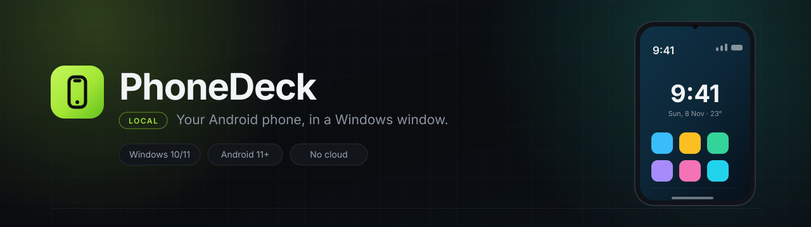
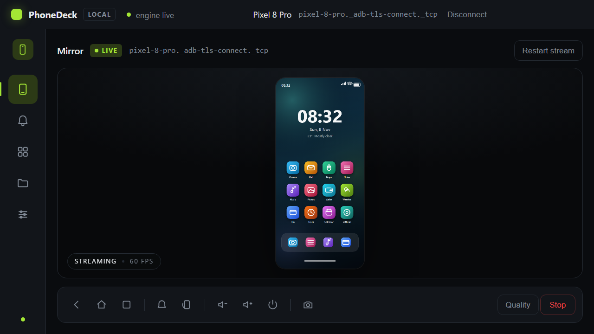
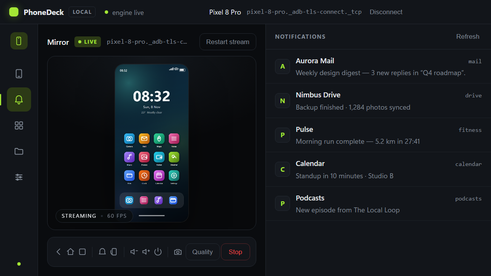
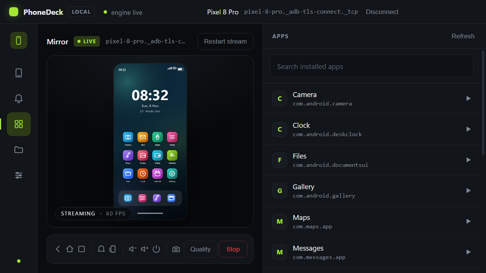
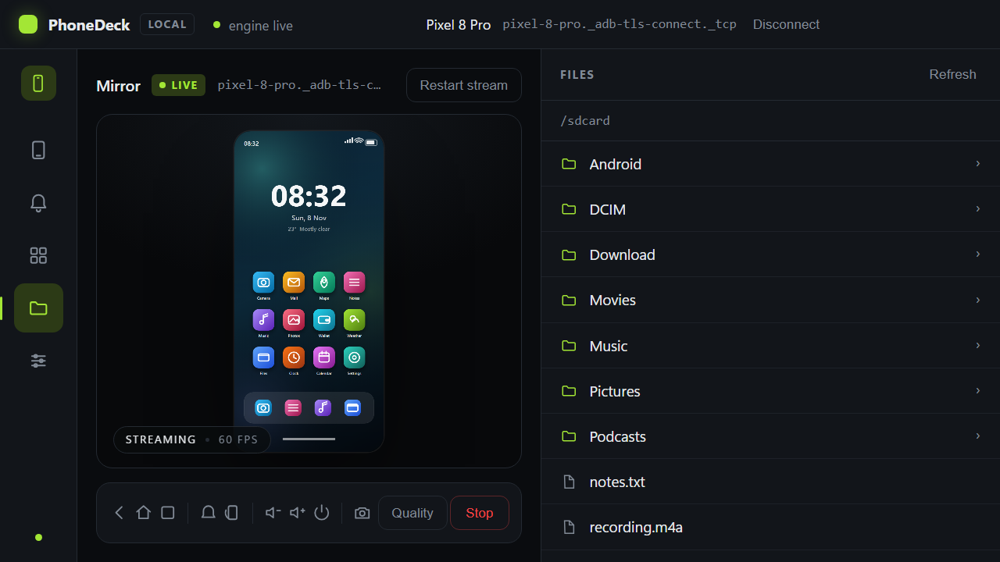
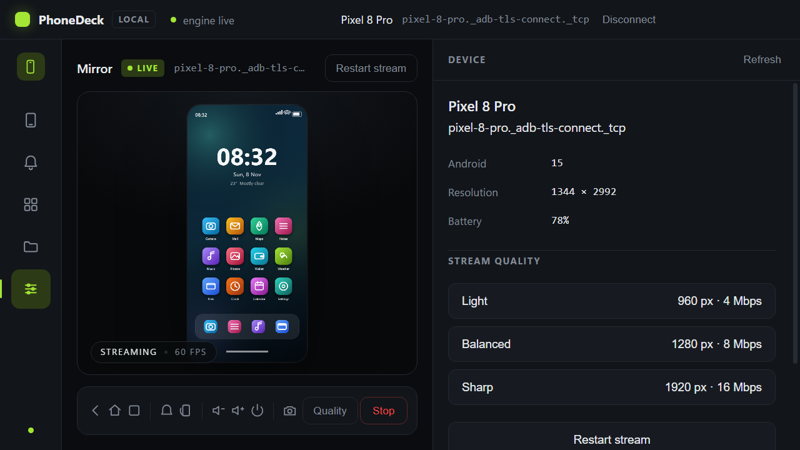
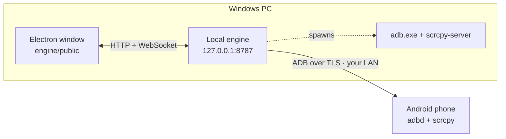

<p align="center">
  
</p>

<p align="center">
  <a href="https://github.com/TanimowoObaloluwaDavid/PhoneDeck/releases"></a>
  <a href="LICENSE"></a>
  
  
  
</p>

<p align="center">
  <b>Mirror and control your Android phone from Windows.</b><br>
  Notifications, apps, files and device info in one window — over your own Wi-Fi.<br>
  No account, no cloud, no telemetry, no “sign in to continue”.
</p>

<p align="center">
  
</p>

---

## Why another phone mirror?

Most “phone on your PC” tools want an account, a subscription, a cloud relay, or all
three. PhoneDeck uses the protocol Android already ships: **ADB**. The desktop app talks to
your phone directly on your LAN, decodes the H.264 stream with the GPU already inside
Windows, and never sends a byte outside your network.

- **Instant** — the stream is scrcpy's encoder, decoded by Chromium's `WebCodecs`.
- **Local** — the engine binds to `127.0.0.1`; the phone is reached over your own Wi-Fi.
- **Small** — a Node engine behind an Electron window, plus the bundled `adb` and `scrcpy-server`.
- **Honest** — no fake “encrypted cloud” claims; see [Limits](#limits-you-should-know).

## Features

| | |
|---|---|
| **Live mirroring** | 60 fps H.264 over WebSocket, GPU-decoded, with a latency HUD. |
| **Real input** | Mouse clicks and drags, wheel scrolling, full keyboard, clipboard-style text entry. |
| **Hardware buttons** | Back, home, recents, rotate, volume up/down, power, screenshot. |
| **Notifications** | The active notification shade, parsed and live-refreshed. |
| **Apps** | Installed app list with search and launch-on-click. |
| **Files** | Browse `/sdcard`, open folders, pull files to your PC. |
| **Device** | Model, Android version, resolution, battery, and stream-quality presets. |
| **Pairing that behaves** | One-click USB setup, code-only Wi-Fi pairing, and automatic reconnect. |

<p align="center">
  
  
</p>
<p align="center">
  
  
</p>

<sub>Screenshots use a simulated Pixel device — no real phone data is included.</sub>

## Requirements

- **Windows 10 or 11** (x64)
- **Android 11+** for wireless debugging, or any Android 8+ over USB
- Phone and PC on the **same Wi-Fi network** (or a USB cable for the initial setup)
- **Node.js 20+** — only if you run from source

No Android SDK is needed: `adb.exe` and `scrcpy-server 3.3.3` ship in `resources/bin`.

## Quick start

```powershell
git clone https://github.com/TanimowoObaloluwaDavid/PhoneDeck.git
cd PhoneDeck
npm install
npm start
```

The window opens, starts its local engine on `127.0.0.1:8787`, and waits for a phone.
You can also double-click `PhoneDeck.cmd`, which installs dependencies on first run.

## Pair your phone (once)

### Fastest — USB

1. Enable **Developer options → USB debugging** and plug the cable in.
2. Press **Set up over USB** in the app.
3. PhoneDeck runs `adb tcpip`, finds the phone's Wi-Fi address, connects, and starts streaming.
4. Unplug the cable. It keeps working.

### Wi-Fi only

1. **Developer options → Wireless debugging → on**
2. Tap **Pair device with pairing code**
3. Type just the **6-digit code** in the app — it discovers the address itself.
4. Press **Pair device**.

After that the app reconnects on its own. Android gives wireless debugging a *new random
port* every time it is switched on; PhoneDeck handles that through mDNS
(`_adb-tls-connect._tcp`), so you never type an address again.

> If the status ever says **Phone offline**, wake the phone and toggle Wireless debugging.
> Do not use `adb connect ip:5555` unless USB `tcpip` was enabled first.

## Using it

| Gesture / key | Action |
|---|---|
| Click, drag | Tap and swipe on the phone |
| Mouse wheel | Scroll |
| Any key | Sent to the phone (modifiers included) |
| `Ctrl+V` | Paste text into the focused field |
| Rail icons | Notifications, apps, files, device |
| Quality | Light `960 px · 4 Mbps` · Balanced `1280 px · 8 Mbps` · Sharp `1920 px · 16 Mbps` |

## How it works



1. The engine pairs once, then talks ADB to `adbd` on the phone.
2. `scrcpy-server` is pushed to `/data/local/tmp` and started.
3. H.264 packets arrive over ADB; each frame is relayed to the window over WebSocket.
4. Chromium decodes with `VideoDecoder` and paints a canvas; input travels back the same way.

New viewers get the cached SPS/PPS and keyframe immediately, so reconnecting never leaves
you on a black screen.

## Engine API

All endpoints are bound to `127.0.0.1:8787`, so nothing outside the machine can reach them.

| Method | Route | Purpose |
|---|---|---|
| `GET` | `/health` | Engine status, adb path, mirror state |
| `GET` | `/devices` | Attached devices (flags mDNS / wireless) |
| `GET` | `/discover` | mDNS pairing + connect services |
| `POST` | `/pair` | Pair with a 6-digit code |
| `POST` | `/setup/usb` | One-click USB → Wi-Fi setup |
| `POST` | `/reconnect` | Saved address first, then mDNS |
| `POST` | `/mirror/start` · `/mirror/stop` | Stream lifecycle |
| `GET` | `/mirror/state` | Current state and video metadata |
| `GET` | `/notifications` · `/apps` · `/files` · `/info` · `/screenshot` | Phone data |
| `POST` | `/apps/launch` · `/keyevent` · `/action` | Phone actions |
| `WS` | `/ws` | Binary video frames + JSON control |

Video framing over the socket: `byte 0` kind (`0` = config, `1` = frame), `byte 1` keyframe
flag, then the payload.

## Repository layout

```
PhoneDeck/
├─ shell/            Electron main process (window, engine lifecycle)
├─ engine/           Node engine: HTTP API, ADB, scrcpy, parsers
│  └─ public/        The desktop UI (HTML/CSS/JS, WebCodecs)
├─ resources/bin/    adb.exe + scrcpy-server
├─ app/              Optional Flutter port of the same UI (needs the Windows toolchain)
└─ docs/             Screenshots, banner, capture harness
```

## Limits you should know

- **Secure windows stay black.** `FLAG_SECURE` apps (banking, DRM video) block capture at the
  OS level. No mirroring tool can show them.
- **Call audio stays on the phone.** Routing it to the PC needs a Bluetooth HFP profile.
- **iPhone is not supported.** Apple exposes no equivalent APIs.
- **Battery** drops roughly 10–15 % per hour while mirroring.
- **Notification text** comes from `dumpsys`; wording varies by manufacturer.
- **Wireless debugging is a developer feature.** It turns off after a reboot and changes port.

## Privacy & security

- The engine listens on `127.0.0.1` only; there is no remote listener and no cloud service.
- Pairing uses Android's authenticated ADB handshake — the phone shows its own consent dialog.
  PhoneDeck cannot connect to a phone that has not explicitly authorised it.
- The only persisted state is the last address, in
  `%LOCALAPPDATA%\PhoneDeck\state.json`. Delete it to forget everything.

## Development

```powershell
npm run engine                       # engine alone
npm start                            # Electron shell + engine
node --check engine/server.mjs       # quick syntax gate
node_modules\.bin\electron docs\capture\capture.cjs   # regenerate screenshots
```

The Flutter port in `app/` is complete but needs Visual Studio's C++ workload:

```powershell
flutter build windows
```

## License

MIT © 2026 Tanimowo Obaloluwa. Bundled `adb` comes from Android Platform Tools
(Apache-2.0); `scrcpy-server` is from [scrcpy](https://github.com/Genymobile/scrcpy) (Apache-2.0).
